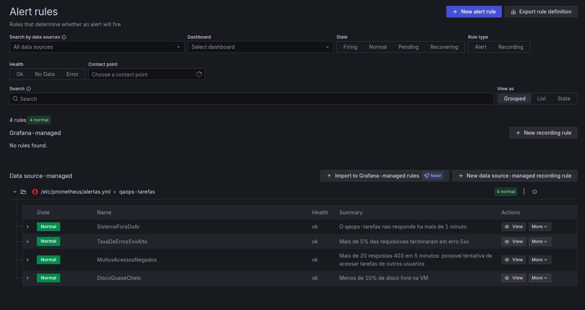
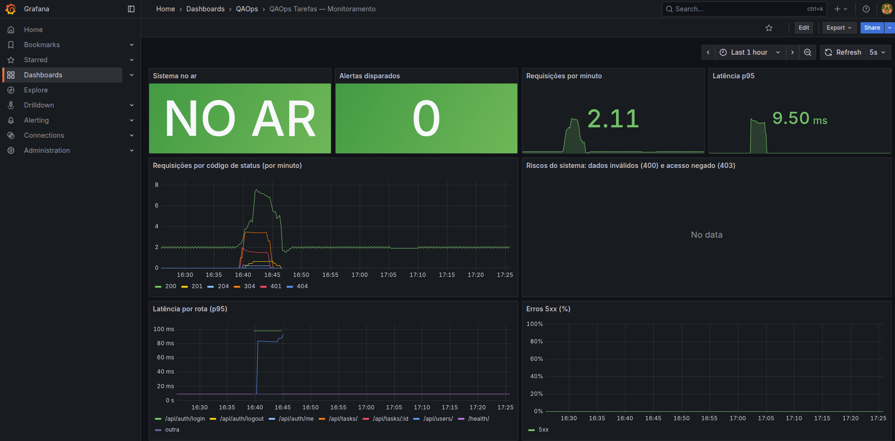
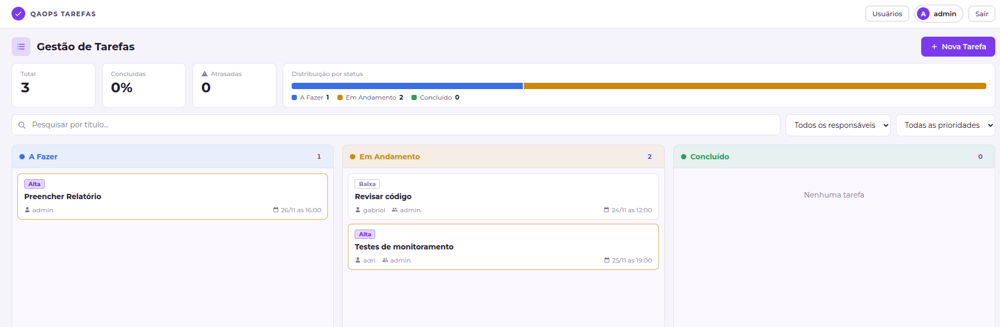
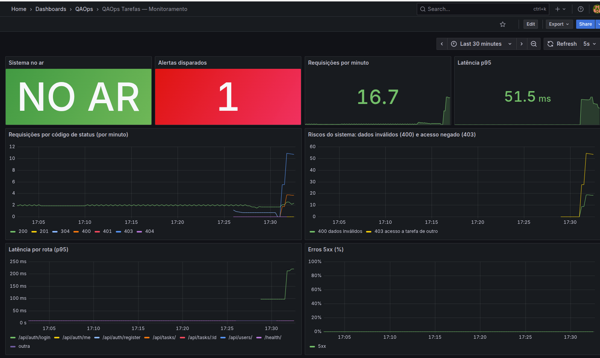
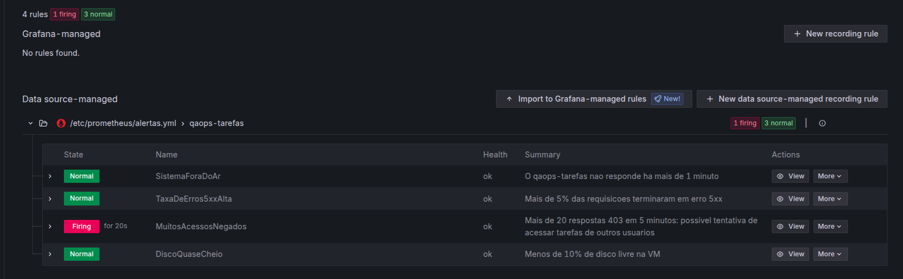
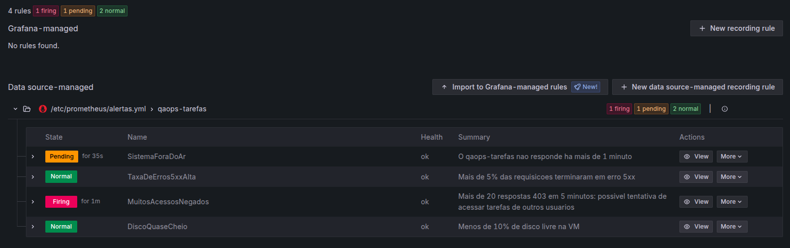
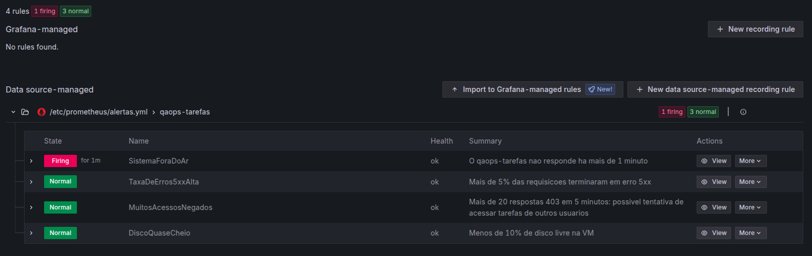
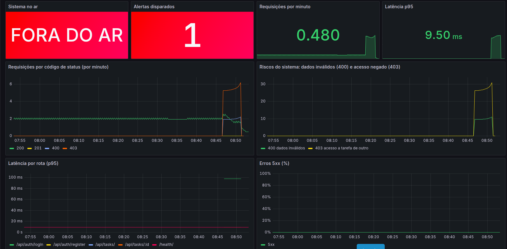
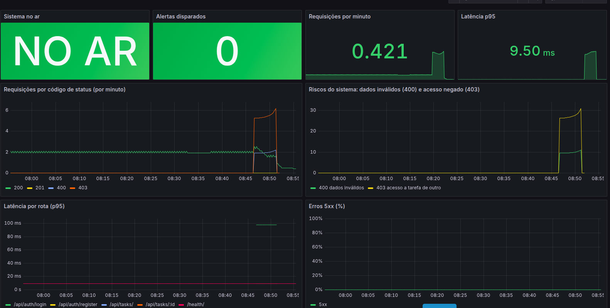

# Relatório Técnico — QAOps Tarefas

## 1. Identificação

- **Integrantes:** Adriana V. Seelig e Gabriel A. S. Espanhol

- **Sistema:** QAOps Tarefas - gerenciador de tarefas (Kanban) standalone

- **Repositório:** [https://github.com/espanha117/qaops-tarefas](https://github.com/espanha117/qaops-tarefas)

- **Plataforma de CI:** GitHub Actions

- **Implantação e monitoramento:** VM com Docker Compose, Prometheus e Grafana

- **Data de entrega:** 26/11/2026

## 2. Contexto

O QAOps Tarefas é um gerenciador de tarefas simples, no formato Kanban de três colunas (todo, doing, done), com login obrigatório e dois papéis de usuário (admin e comum), construído como sistema-base para este trabalho prático. Foi desenvolvido deliberadamente pequeno — a disciplina não avalia complexidade do sistema, e sim a qualidade integrada ao fluxo de entrega em volta dele.

**Stack técnica:** Node.js + Express no backend, SQLite via módulo nativo node:sqlite para persistência (sem dependência externa nem passo de compilação — decisão tomada justamente para manter o requisito de "instalação reproduzível" o mais simples e confiável possível para qualquer avaliador). Autenticação é sessão via cookie HttpOnly, com senha em hash scrypt (node:crypto) — também sem dependência externa, pela mesma razão. Frontend estático em HTML/CSS/JS puro servido pelo próprio Express.

**Arquitetura resumida:** camadas HTTP finas (src/routes/tasks.js, auth.js, users.js, health.js), delegando toda regra de negócio para uma camada de serviço isolada e pura (src/services/taskService.js, authService.js, sessionService.js), que recebe a conexão SQLite por injeção de dependência. Essa separação é o que permite testar as regras de negócio sem precisar subir um servidor HTTP (testes unitários) e, separadamente, testar a API real de ponta a ponta (testes de integração). Um middleware (src/middleware/auth.js) resolve a sessão a partir do cookie e injeta req.user; taskService usa esse usuário para filtrar e autorizar cada operação por dono da tarefa. A rota pública /health informa se o processo está no ar e se o banco responde, e é usada pelo smoke test do pipeline e pelo monitoramento. Um servidor separado, numa porta interna que não é exposta fora da VM (9464), publica em /metrics as métricas no formato do Prometheus (src/metrics.js).

**Funcionalidade estudada:** CRUD de tarefas com validação de campos e transição de status, com controle de acesso por usuário (dono da tarefa vê/edita, admin vê/edita tudo), detalhado na seção 3.

## 3. Riscos

| **Risco**                                                                                             | **Por que importa**                                                                        | **Verificação associada**                                                                       |
|-------------------------------------------------------------------------------------------------------|--------------------------------------------------------------------------------------------|-------------------------------------------------------------------------------------------------|
| Aceitar tarefa sem título (ou só espaços) , ou com mais de 200 caracteres                             | Corrompe a listagem e o board, gera itens sem identificação.                               | Testes unitários (incluindo os limites de 200 e 201 caracteres) + gate de testes                |
| Aceitar status/priority fora do enum permitido                                                        | Quebra o agrupamento por coluna no Kanban.                                                 | Teste unitário + gate de testes                                                                 |
| due_date inválida persistida                                                                          | Quebra ordenação/exibição de prazos no frontend.                                           | Teste unitário + gate de testes                                                                 |
| Regressão na transição de status (completed_at não atualizado)                                        | Métricas de conclusão ficam erradas.                                                       | Teste unitário dedicado + gate de testes                                                        |
| Usuário comum acessando/alterando tarefa de outro usuário                                             | Vazamento de dados entre usuários; quebra o isolamento que é a própria razão de ter login. | Testes unitários e de integração dedicados (verificam 403) + gate de testes                     |
| Senha armazenada ou comparada de forma insegura (texto puro, hash sem salt, comparação não constante) | Comprometimento de credenciais em caso de vazamento do banco.                              | Uso de scrypt com salt por usuário e timingSafeEqual, coberto por teste unitário                |
| Sessão sem expiração ou cookie acessível via JavaScript                                               | Sessão roubada (XSS) ou válida indefinidamente.                                            | Cookie HttpOnly, TTL de 7 dias, teste unitário de expiração                                     |
| Lógica de negócio sem cobertura de teste                                                              | Bugs silenciosos em mudanças futuras.                                                      | Gate de cobertura mínima                                                                        |
| Dependência com vulnerabilidade conhecida                                                             | Superfície de ataque desnecessária.                                                        | Gate de auditoria de dependências                                                               |
| Código com padrão inseguro/óbvio não identificado                                                     | Bug ou vulnerabilidade que passa despercebida.                                             | Gate de análise estática                                                                        |
| Vulnerabilidade publicada depois do último commit                                                     | O código não muda, mas passa a usar um componente vulnerável.                              | Execução agendada semanal do pipeline + Dependabot                                              |
| Atualização de dependência que quebra compatibilidade                                                 | Uma versão nova pode mudar o comportamento do framework.                                   | PRs do Dependabot passam pelos gates; atualizações major exigem revisão humana                  |
| Aplicação que passa nos testes, mas não sobe                                                          | Erro de inicialização ou banco inacessível só apareceria em uso.                           | Gate 6 (smoke test em /health)                                                                  |
| Sistema fora do ar ou lento em produção                                                               | Usuários sem acesso, sem ninguém perceber.                                                 | Regras de alerta no Prometheus, exibidas no Grafana (sem notificação automática; ver seção 4.1) |

## 4. Pipeline

**Arquivo:** \`.github/workflows/ci.yml\`.

**Gatilhos**: push (qualquer branch) e pull_request para a branch principal (master) — cobre tanto o fluxo de desenvolvimento em branch quanto a validação antes de merge.

Além disso, uma execução agendada (schedule, toda segunda-feira às 9h UTC) roda o pipeline mesmo sem commits, e o acionamento manual (workflow_dispatch) permite repetir uma execução sob demanda. O Dependabot (.github/dependabot.yml) verifica as dependências npm semanalmente e abre PRs de atualização, que passam pelos mesmos gates antes de qualquer merge.

**Fluxo de decisão:** cada etapa roda em sequência. Se uma falhar, as seguintes não executam e o job é marcado como falho.

| **Ordem** | **Etapa**                 | **Ferramenta**                       | **Resultado**                                  |
|-----------|---------------------------|--------------------------------------|------------------------------------------------|
| 1         | Checkout + setup Node     | actions/checkout, actions/setup-node | Ambiente pronto                                |
| 2         | Dependências              | npm ci                               | Instalação reprodutível a partir do lockfile   |
| 3         | Análise estática          | npm run lint (ESLint)                | Código sem padrões proibidos                   |
| 4         | Testes                    | npm test (Vitest)                    | Comportamentos verificados                     |
| 5         | Cobertura                 | npm run coverage                     | Lógica crítica coberta acima do limiar         |
| 6         | Auditoria de dependências | npm audit --audit-level=high         | Sem vulnerabilidade alta/crítica conhecida     |
| 7         | Smoke test                | npm start + curl em /health          | Aplicação sobe e responde, com banco acessível |
| 8         | Publicação de evidências  | actions/upload-artifact              | Relatório de cobertura anexado à execução      |

O histórico de execuções na aba Actions do repositório é a evidência primária de cada rodada do pipeline.

### 4.1 Implantação e monitoramento

Para cobrir as etapas DEPLOY, OPERATE e MONITOR do ciclo DevOps, o sistema é implantado **numa VM mantida pela Adriana: VER AQUI**

| **Componente**                                  | **Papel**                                                                                          |
|-------------------------------------------------|----------------------------------------------------------------------------------------------------|
| VM atrás de firewall pfSense, acessível por VPN | Ambiente de execução isolado; não fica exposto diretamente à internet.                             |
| Docker Compose                                  | Sobe a aplicação, o Prometheus e o Grafana juntos, de forma declarativa e reproduzível.            |
| Contêiner da aplicação (Dockerfile)             | Executa o QAOps Tarefas; a política de reinício do Compose o religa automaticamente se ele cair.   |
| Volume Docker                                   | Guarda o arquivo SQLite fora do contêiner, então os dados sobrevivem a novos deploys.              |
| Arquivo .env só na VM                           | Senha do admin e demais segredos ficam fora do repositório.                                        |
| Prometheus                                      | Coleta periodicamente as métricas expostas pela aplicação em /metrics e avalia 4 regras de alerta. |
| Grafana                                         | Painéis de disponibilidade e desempenho, com os alertas do Prometheus em destaque.                 |

As regras de alerta ficam no Prometheus: quando uma condição é atingida, o alerta passa ao estado firing e aparece na interface do Prometheus e no painel do Grafana. Não há notificação automática (e-mail ou mensagem); alguém precisa estar olhando o painel para perceber.

As métricas são expostas pela biblioteca prom-client numa porta interna da aplicação (9464), que não é publicada fora da VM, e coletadas pelo Prometheus a cada 15 segundos. São três grupos:

- **Requisições HTTP:** a métrica http_request_duration_seconds, um histograma com o método, a rota e o código de status de cada requisição. A rota é registrada pelo padrão (por exemplo, /api/tasks/:id), nunca pelo identificador real, para não criar uma série nova a cada tarefa. Dela saem a quantidade de requisições, a taxa de erros e a latência (p95).

- **Processo Node.js:** as métricas padrão do processo, como uso de CPU e memória.

- **VM:** CPU, memória e disco, coletados pelo node-exporter.

As 4 regras de alerta, versionadas no arquivo monitoring/alertas.yml, são:

- **SistemaForaDoAr** (crítica): o Prometheus não consegue coletar a aplicação por mais de 1 minuto.

- **TaxaDeErros5xxAlta** (alta): mais de 5% das requisições terminam em erro 5xx durante 2 minutos.

- **MuitosAcessosNegados** (média): mais de 20 respostas 403 em 5 minutos, o que indica uma possível tentativa de acessar tarefas de outros usuários (risco da seção 3).

- **DiscoQuaseCheio** (alta): menos de 10% de disco livre na VM durante 5 minutos.

O painel do Grafana ("QAOps Tarefas — Monitoramento") é provisionado por arquivo, junto com o restante da configuração, e mostra: sistema no ar, alertas disparados, requisições por minuto, latência p95, requisições por código de status, os riscos do sistema (respostas 400 e 403), latência por rota, percentual de erros 5xx e o uso de CPU, memória e disco da VM. A Figura 1 mostra as 4 regras carregadas no Grafana.

*Figura 1 – Regras de alerta do Prometheus exibidas no Grafana, todas em estado normal*

Como uma versão aprovada chega à VM. Como a VM só é acessível pela VPN, os runners do GitHub Actions (que rodam na nuvem) não conseguem se conectar a ela. Por isso, o deploy é manual: depois que uma versão passa pelos 6 gates e entra na master, a Adriana atualiza a VM com git pull && docker compose up -d --build. Chegamos a montar um job de deploy automático por SSH (PR \#37), mas ele foi fechado sem merge porque não alcança a VM atrás da VPN e não usa Docker. A alternativa para automatizar seria um self-hosted runner instalado na própria VM, que busca os jobs no GitHub por conexão de saída; isso ficou como trabalho futuro (seção 8.6).

## 5. Testes

A estratégia utiliza dois níveis de testes, com o objetivo de cobrir os comportamentos de risco identificados na Seção 3: testes unitários e testes de integração/API. No total, são 80 testes**.**

### 5.1 Testes Unitários

Testam cada camada de serviço isoladamente, utilizando um banco de dados SQLite em memória injetado. Não dependem de requisições HTTP e possuem execução rápida.

| **Arquivo**            | **O que é testado**                                                                                                                                                                                                                                                                                                                                                                                                                   |
|------------------------|---------------------------------------------------------------------------------------------------------------------------------------------------------------------------------------------------------------------------------------------------------------------------------------------------------------------------------------------------------------------------------------------------------------------------------------|
| taskService.test.js    | Criação e atualização de tarefas válidas; rejeição de título vazio, título acima de 200 caracteres, status e prioridades inválidos e datas inválidas; caso de borda de um título com exatamente 200 caracteres; atualização de completed_at nas transições de status; controle de acesso por proprietário (usuário comum acessa apenas suas tarefas e administrador acessa todas); lançamento de ForbiddenError em acessos indevidos. |
| authService.test.js    | Criação de usuários; validação de username, senha e role; verificação de unicidade; autenticação com credenciais válidas e inválidas (AuthError); listagem de usuários sem exposição de hash ou salt das senhas.                                                                                                                                                                                                                      |
| sessionService.test.js | Criação, resolução e expiração de sessões, além da invalidação da sessão durante o logout.                                                                                                                                                                                                                                                                                                                                            |

### 5.2 Testes de integração/API (test/integration/)

Utilizam a ferramenta Supertest para testar a aplicação Express real, diretamente pelo objeto app, sem precisar executar listen. Validam os endpoints REST de ponta a ponta.

| **Arquivo**         | **O que é testado**                                                                                                                                                                                                                               |
|---------------------|---------------------------------------------------------------------------------------------------------------------------------------------------------------------------------------------------------------------------------------------------|
| tasks.api.test.js   | Verificação dos códigos HTTP (201, 400, 401, 403, 404 e 204); validação de que a listagem e a edição respeitam o isolamento entre usuários comuns e administradores.                                                                              |
| auth.api.test.js    | Login com cookie de sessão; retorno 401 para credenciais inválidas ou ausência de sessão; invalidação da sessão após o logout.                                                                                                                    |
| users.api.test.js   | Restrição da criação e listagem de usuários ao administrador (403 para usuário comum); retorno 400 para username duplicado.                                                                                                                       |
| health.api.test.js  | Verificação de que o endpoint /health responde com 200 sem necessidade de sessão e com 503 quando o banco de dados está indisponível.                                                                                                             |
| metrics.api.test.js | Verificação de que /metrics responde no formato do Prometheus no servidor de métricas; de que /metrics não está disponível na porta pública da aplicação (404); e de que as requisições são contadas pelo padrão da rota e pelo código de status. |

A utilização dos dois níveis permite verificar tanto a lógica interna quanto o funcionamento da aplicação como um todo.

- **Testes unitários:** garantem que as regras de negócio funcionem corretamente de forma isolada, identificando erros nos serviços e nas validações.

- **Testes de integração:** garantem que a camada HTTP esteja corretamente conectada à lógica de negócio, verificando roteamento, serialização de dados, autenticação e tratamento de erros.

Essa divisão é importante porque um teste unitário aprovado não garante que uma rota exponha o comportamento esperado, assim como um teste de integração não substitui a verificação isolada das regras de negócio. Os testes do limite de 200 caracteres foram validados alterando o limite de propósito para 199 e para 201: em cada caso, um teste falhou, o que confirma que eles detectam a mudança.

## 6. Quality Gates

Foram estabelecidos seis Quality Gates (critérios de qualidade), todos bloqueantes. Isso significa que, se qualquer um deles falhar, o pipeline não será aprovado e sua execução será interrompida.

| **Gate**         | **Critério mensurável**                                                | **Justificativa (risco)**                                                              | **Momento de execução**                          | **Evidência**                               | **Consequência**                                | **Limitação/exceção**                                                                       |
|------------------|------------------------------------------------------------------------|----------------------------------------------------------------------------------------|--------------------------------------------------|---------------------------------------------|-------------------------------------------------|---------------------------------------------------------------------------------------------|
| Build/Install    | npm ci retorna código 0.                                               | Dependência quebrada ou lockfile divergente impede a execução do sistema.              | Início do job, a cada push/PR.                   | Log da etapa no Actions.                    | Bloqueia o pipeline.                            | Não valida o comportamento em runtime, apenas a instalação.                                 |
| Análise estática | 0 erros do ESLint (regras recomendadas + no-unused-vars e eqeqeq).     | Padrões inseguros e bugs evidentes não identificados pelos testes.                     | Após a instalação.                               | Log do ESLint no Actions.                   | Bloqueia o pipeline.                            | Não substitui a revisão humana e cobre apenas as regras configuradas.                       |
| Testes           | 100% dos testes unitários e de integração aprovados.                   | Regressões na criação, validação ou transição de status das tarefas.                   | Após o lint.                                     | Saída do Vitest no log do Actions.          | Bloqueia o pipeline.                            | Cobre apenas comportamentos que possuem testes escritos.                                    |
| Cobertura        | ≥75% de linhas/statements/funções e ≥60% de branches em src/services/. | Lógica de negócio crítica sem verificação automatizada.                                | Após os testes.                                  | Relatório de cobertura v8 (artifact + log). | Bloqueia o pipeline.                            | Cobertura alta é um indicador de qualidade, mas não garante ausência de bugs.               |
| Dependências     | 0 vulnerabilidades high/critical no npm audit.                         | Utilização de pacotes com vulnerabilidades conhecidas.                                 | Após a cobertura e na execução agendada semanal. | Log do npm audit no Actions.                | Bloqueia e exige revisão manual da dependência. | Cobre apenas vulnerabilidades conhecidas no registry npm.                                   |
| Smoke test       | GET /health responde 200 em até 20 segundos após npm start.            | Código que passa nos testes, mas não consegue iniciar corretamente ou acessar o banco. | Após a auditoria.                                | Resposta JSON do /health no log do Actions. | Bloqueia o pipeline.                            | Verifica apenas se a aplicação inicia e responde, sem testar funcionalidades ou desempenho. |

Os critérios de cobertura e auditoria foram definidos considerando o equilíbrio entre segurança, confiabilidade e praticidade na execução do pipeline.

- Cobertura de 75% em linhas, statements e funções: foi escolhida por representar um patamar elevado de cobertura da lógica de negócio, especialmente nos módulos de maior risco, sem exigir 100%, o que poderia gerar testes artificiais apenas para atingir um número.

- Cobertura de 60% em branches: esse limite é mais permissivo porque a função update possui combinações de campos opcionais que geram diversos caminhos de execução. Exigir 75% poderia resultar em testes redundantes sem aumentar significativamente a confiança no sistema.

- Auditoria com nível high: foi escolhida para evitar que vulnerabilidades de baixo impacto gerem bloqueios desnecessários, mantendo a interrupção do pipeline concentrada em vulnerabilidades de maior gravidade.

Dessa forma, os Quality Gates ajudam a impedir que alterações com falhas conhecidas avancem no processo de desenvolvimento, mantendo um nível mínimo de qualidade e segurança do software.

Depois dos gates. Os gates decidem se uma versão pode avançar; o monitoramento na VM (seção 4.1) verifica se ela continua funcionando depois de implantada. Como o deploy é manual, a verificação pós-deploy também é: depois do docker compose up, confere-se que /health responde 200 e que o painel do Grafana volta a mostrar a aplicação no ar.

## 7. Experimentos

Os três cenários foram executados em 26/10/2026 e estão preservados na aba Actions do repositório. Nessa data, o pipeline tinha 5 gates e 73 testes; o Gate 6 (smoke test) e os testes de limite do título foram adicionados depois.

| **Cenário**   | **Procedimento**                                                                                                                                                                                    | **Resultado**                                                                                                                                                                                                                                                                                                                                                         |
|---------------|-----------------------------------------------------------------------------------------------------------------------------------------------------------------------------------------------------|-----------------------------------------------------------------------------------------------------------------------------------------------------------------------------------------------------------------------------------------------------------------------------------------------------------------------------------------------------------------------|
| **Aprovado**  | Push na branch master com o código íntegro (commit 7f570a5).                                                                                                                                        | Todos os 5 gates aprovados, em 20 segundos. [Visualizar execução](https://github.com/espanha117/qaops-tarefas/actions/runs/40379359112).                                                                                                                                                                                                                       |
| **Reprovado** | Na branch experimento/falha-controlada, commit 112c45d, foram removidas deliberadamente as 3 linhas responsáveis por validar títulos vazios em src/services/taskService.js (validateCreatePayload). | Gates 1 e 2 (build e lint) aprovados. **Gate 3 (Testes) reprovado**, com 2 dos 73 testes falhando: o teste unitário create \> rejeita titulo vazio e o teste de integração POST /api/tasks \> retorna 400 para titulo vazio. Os gates 4 e 5 não foram executados. [Visualizar execução](https://github.com/espanha117/qaops-tarefas/actions/runs/40381350067). |
| **Correção**  | O commit 1f41b5b realizou o revert da alteração anterior, restaurando a validação removida na mesma branch.                                                                                         | Todos os 5 gates voltaram a ser aprovados, em 23 segundos. [Visualizar execução](https://github.com/espanha117/qaops-tarefas/actions/runs/40381495351).                                                                                                                                                                                                        |

A comparação entre as execuções demonstra que a única diferença entre o cenário aprovado e o reprovado foi a remoção de uma verificação de apenas três linhas de código.

Essa alteração foi suficiente para demonstrar que o pipeline impede que uma modificação que compromete um comportamento coberto por testes avance no fluxo de entrega.

O build e o lint foram aprovados porque o código continuava sintaticamente válido. A falha foi identificada pelo Gate 3 (Testes), tanto no nível unitário quanto no nível de integração.

Esse resultado confirma a importância de manter as duas camadas de testes, pois ambas identificaram o mesmo problema em diferentes níveis da aplicação.

### 7.1 Reprovação não planejada: auditoria de dependências

Como evidência adicional, em 19/10/2026, dois pushes na branch master foram bloqueados pelo Gate 5 (Auditoria de dependências), mesmo sem alterações relacionadas a essas dependências no código do sistema.

Após a última execução aprovada, em 14/09, foram publicadas três vulnerabilidades em dependências indiretas:

| **Dependência** | **Severidade** | **Origem**                                           |
|-----------------|----------------|------------------------------------------------------|
| proxy-addr      | Critical       | Utilizada pelo Express                               |
| brace-expansion | High           | Utilizada pelo ESLint                                |
| source-map-js   | High           | Utilizada pelo Vitest e pela ferramenta de cobertura |

Correção realizada: as dependências foram atualizadas dentro das faixas de versão já permitidas no package.json, utilizando o comando npm update, no commit ab15a66.

Após a atualização, o pipeline voltou a ser aprovado na execução 40379359112.

Esse caso demonstra que o gate de auditoria também protege o projeto contra riscos externos, decorrentes de vulnerabilidades descobertas em dependências utilizadas pela aplicação. Ele também motivou a execução agendada semanal: sem ela, o problema só foi descoberto porque alguém fez push.

### 7.2 Smoke test e ciclo do Dependabot

**Smoke test (Gate 6).** Adicionado em 16/11/2026 (PR \#28). O log do gate registra a resposta da aplicação em execução no runner, {"status":"ok","uptime":1,"db":"ok"}, seguida de "Smoke test aprovado: /health respondeu 200". Execução: [https://github.com/espanha117/qaops-tarefas/actions/runs/43865239327](https://github.com/espanha117/qaops-tarefas/actions/runs/43865239327)

**Ciclo do Dependabot.** Logo após ser ativado, em 16/11/2026, o Dependabot abriu 5 PRs de atualização, e os 6 gates aprovaram todos. Quatro atualizações foram aceitas (globals, supertest, vitest e @vitest/coverage-v8). A do Express 4 → 5 (PR \#31) foi recusada mesmo com o pipeline verde: é uma versão major, com mudanças incompatíveis, e os testes não cobrem o frontend. A decisão ficou registrada no PR. Durante os merges, um PR ficou em conflito no package-lock.json e foi refeito pelo próprio Dependabot (@dependabot rebase).

### 7.3 Monitoramento na VM

A implantação na VM foi verificada em 23 e 24/11/2026 em quatro cenários: funcionamento normal, detecção dos riscos do sistema, queda da aplicação e recuperação. Nos prints, a barra de endereço do navegador foi cortada para não expor o endereço do servidor.

**Funcionamento normal.** O painel mostra a aplicação no ar, nenhum alerta disparado e as requisições por código de status e por rota (Figura 2). A linha constante em cerca de 2 requisições por minuto corresponde às verificações automáticas do Docker no /health, a cada 30 segundos. O sistema ficou acessível com o administrador criado a partir das variáveis do .env (Figura 3).

*Figura 2 – Painel do Grafana com a aplicação no ar e nenhum alerta disparado*

*Figura 3 – QAOps Tarefas em execução na VM, com o administrador conectado*

**Detecção dos riscos do sistema.** Foram enviadas pela API, de propósito, 8 tarefas sem título, rejeitadas com 400, e 25 tentativas de um usuário comum abrir uma tarefa do administrador, bloqueadas com 403. O painel registrou as duas situações, que correspondem aos dois riscos principais da seção 3 (Figura 4). Como houve mais de 20 respostas 403 em 5 minutos, a regra MuitosAcessosNegados disparou (Figura 5) e voltou sozinha ao estado normal quando as respostas saíram da janela de 5 minutos. A latência do login, perto de 200 ms, é esperada: a senha usa o hash scrypt, que é lento de propósito para dificultar ataques de força bruta.

Na primeira tentativa, as respostas não apareceram nos gráficos: o Prometheus calcula o aumento de um contador comparando duas coletas, e um contador que surge pela primeira vez não tem coleta anterior; além disso, o contêiner foi parado logo em seguida, e os contadores, que ficam em memória, recomeçaram do zero. Com a aplicação no ar, a rajada foi repetida e registrada normalmente.

*Figura 4 – Painel com as respostas 400 (dados inválidos) e 403 (acesso a tarefa de outro usuário) e um alerta disparado*

*Figura 5 – Regra MuitosAcessosNegados em estado firing; as demais em estado normal*

**Queda da aplicação.** O contêiner da aplicação foi parado de propósito com docker compose stop app. A regra SistemaForaDoAr passou primeiro ao estado pending, porque espera 1 minuto antes de disparar, o que evita alarmes por falhas passageiras (Figura 6), e depois ao estado firing (Figura 7). No painel, o indicador mudou para FORA DO AR, com o alerta contabilizado (Figura 8).

*Figura 6 – Regra SistemaForaDoAr em estado pending, aguardando 1 minuto para confirmar a queda*

*Figura 7 – Regra SistemaForaDoAr em estado firing, após 1 minuto com a aplicação fora do ar*

*Figura 8 – Painel com a aplicação fora do ar e o alerta disparado*

**Recuperação.** A aplicação foi religada manualmente com docker compose start app. A política de reinício do Compose (restart: unless-stopped) religa o contêiner sozinha apenas quando ele cai por falha; uma parada feita de propósito com stop é respeitada, por isso o retorno foi manual. Em cerca de 1 minuto, o painel voltou a mostrar a aplicação no ar e o alerta foi resolvido (Figura 9). O intervalo sem dados nos gráficos marca o período em que a aplicação ficou parada. As tarefas cadastradas foram preservadas, porque o banco fica no volume do Docker, fora do contêiner.

*Figura 9 – Painel após a recuperação: aplicação no ar e nenhum alerta disparado*

### 7.4 Limitação Observada

Durante a execução reprovada, a etapa Publicar evidências foi executada devido à configuração if: always(), mas não encontrou a pasta coverage/, pois o Gate 4 (Cobertura) não chegou a ser executado.

Consequentemente, não foi gerado um artefato de cobertura para essa execução. A evidência da falha ficou disponível apenas no log do Gate 3.

Melhoria proposta: implementar a geração de um relatório de testes no formato JUnit XML e configurar sua publicação mesmo quando houver falhas, garantindo que os resultados dos testes permaneçam disponíveis como artefatos do pipeline.

## 8. Análise Crítica

### 8.1. Quais riscos foram efetivamente cobertos e quais permaneceram?

Os riscos de validação de entrada, transição de status e controle de acesso (seção 3) estão cobertos por testes automatizados e pelo gate de cobertura. O Gate 6 cobre a aplicação que não sobe, e a execução agendada com o Dependabot cobre vulnerabilidades publicadas depois do último commit. Não foram cobertos riscos de concorrência (duas requisições simultâneas alterando a mesma tarefa) nem testes de carga. As métricas no Grafana mostram o desempenho real, mas não substituem um teste de carga.

### 8.2. O pipeline fornece feedback rápido e compreensível?

Sim. O pipeline executa entre 25 e 40 segundos, e cada gate possui um log separado, o que permite identificar imediatamente onde ocorreu a falha (como no experimento reprovado).

### 8.3. Quais verificações continuam manuais?

- Revisão de código: os pull requests são revisados e aprovados por outra pessoa antes do merge.

- Validação visual do Kanban no navegador, que os testes automatizados não cobrem.

- A decisão de corrigir ou não uma vulnerabilidade moderate apontada pelo npm audit, que não bloqueia o pipeline.

- Aceitação de atualizações major propostas pelo Dependabot: o caso do Express 5 mostra que pipeline verde não basta quando os testes não cobrem tudo o que a atualização pode afetar.

- O deploy de novas versões na VM e a conferência depois dele (o /health e o painel do Grafana).

### 8.4. Qual é o custo de manter os testes e gates?

Atualmente, o custo é baixo: são 80 testes, executados em poucos segundos. Porém, novas funcionalidades exigem atualização dos testes e, quando necessário, dos critérios de cobertura. O Dependabot acrescenta PRs semanais para revisar e conflitos no package-lock.json quando vários entram em sequência. A VM acrescenta a manutenção do Docker, do Prometheus e do Grafana.

### 8.5. O que diferencia automação isolada de uma prática DevOps/QAOps?

Automação isolada seria apenas ter um script de teste. Aqui, a qualidade está integrada ao fluxo de entrega: cada push executa verificações automáticas, o pipeline bloqueia alterações com falhas, roda periodicamente para detectar riscos externos e mantém um histórico auditável das execuções no GitHub Actions. Com a VM, o ciclo se fecha: o que o monitoramento mostra em produção volta como informação para o planejamento.

### 8.6. O que seria necessário para incluir implantação e observabilidade com segurança?

Parte disso foi adotada: implantar apenas versões aprovadas pelos gates; manter segredos fora do repositório (.env só na VM); isolar o ambiente (VM atrás de pfSense, com acesso só pela VPN ou por IPs autorizados); manter os dados fora do contêiner (volume); e ter observabilidade com health check, métricas e regras de alerta (Prometheus) e painéis (Grafana).

Ainda faltam a notificação dos alertas (hoje eles só aparecem na tela; o próximo passo seria um contato de e-mail ou Telegram, via Alertmanager ou Grafana), o deploy automático com verificação e rollback, backup do volume do SQLite, logs centralizados e HTTPS. Para o deploy automático, um self-hosted runner em repositório público pode executar código de PRs de terceiros; por isso, ele deveria atender apenas jobs de push na master, com aprovação manual para workflows vindos de forks.

## 9. Contribuições

| **Integrante**         | **Contribuição**                                                                                                                                                                                                                                                                                                                                                             |
|------------------------|------------------------------------------------------------------------------------------------------------------------------------------------------------------------------------------------------------------------------------------------------------------------------------------------------------------------------------------------------------------------------|
| Adriana V. Seelig      | README (pré-requisitos, passo a passo de instalação e contribuição), checklist de acompanhamento do trabalho, identificação da dupla no relatório; implantação na VM com Docker Compose, endpoint de métricas e seus testes, Prometheus e Grafana para monitoramento, com painel e regras de alerta (seção 4.1), e os testes e evidências do monitoramento na VM (seção 7.3) |
| Gabriel A. S. Espanhol | Sistema base (Kanban, login e controle de acesso, interface), pipeline e quality gates, experimentos (seção 7), correção das dependências vulneráveis, monitoramento do pipeline (/health, smoke test, execução agendada e Dependabot), testes de limite do título e redação do relatório                                                                                    |

A autoria de cada alteração fica identificável no histórico de commits e nos pull requests do repositório.

## 10. Referências

DORA. Disponível em: [https://dora.dev/](https://dora.dev/)

GitHub Actions. Disponível em: [https://docs.github.com/actions](https://docs.github.com/actions)

GitHub Dependabot. Disponível em: [https://docs.github.com/code-security/dependabot](https://docs.github.com/code-security/dependabot)

OWASP. Disponível em: [https://owasp.org/](https://owasp.org/)

ISTQB CTFL v4.0. Disponível em: [https://istqb.org/certifications/certified-tester-foundation-level-ctfl-v4-0/](https://istqb.org/certifications/certified-tester-foundation-level-ctfl-v4-0/)

Vitest. Disponível em: [https://vitest.dev/](https://vitest.dev/)

ESLint. Disponível em: [https://eslint.org/](https://eslint.org/)

Node.js node:sqlite. Disponível em: [https://nodejs.org/api/sqlite.html](https://nodejs.org/api/sqlite.html)

Docker Compose. Disponível em: [https://docs.docker.com/compose/](https://docs.docker.com/compose/)

Prometheus. Disponível em: [https://prometheus.io/docs/](https://prometheus.io/docs/)

Grafana. Disponível em: [https://grafana.com/docs/](https://grafana.com/docs/)
